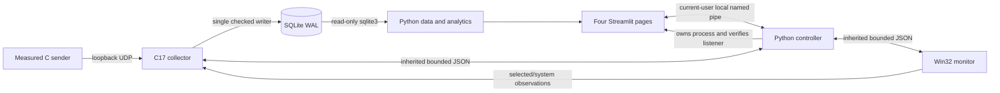

# PulseMetrics V2

Local Windows performance analytics with a genuine C17 metrics collector and a Python presentation layer. PulseMetrics turns real system, selected-process and instrumented application observations into traceable live views, alerts and historical windows.

## Features

- **Overview:** live CPU/RAM, resource trends, tracked processes and collector health.
- **Process Explorer:** discovery, identity-safe tracking/untracking and ended/unavailable states.
- **Performance Analytics:** source/time selection, counters, gauges, measured timers and threshold evidence.
- **Performance Time Machine:** stored windows, honest gaps and compatible historical comparisons.
- Local retention, settings, graceful exit/restart and offline operation after dependency installation.

## Architecture



C owns UDP reception, parsing, validation, aggregation, synchronization, resource limits, alerts and the single SQLite writer. The native monitor uses Win32 process identity and sampling. Python controls lifecycle and reads telemetry; it does not replace the systems programming core.

**Stack:** C17, Win32, Winsock, SQLite WAL; Python/sqlite3, Pandas, Streamlit, Plotly; UCRT64 GCC, CMake, Ninja; CTest and pytest. See [contracts and ERD](docs/architecture.md).

## Install, build and launch

Windows x64 is required. Follow [setup and troubleshooting](docs/setup.md) for official MSYS2 UCRT64 installation and tested versions. From this repository in PowerShell:

```powershell
python -m venv ..\PulseMetrics_V2_ENV
..\PulseMetrics_V2_ENV\Scripts\python.exe -m pip install -r requirements.lock.txt
..\PulseMetrics_V2_ENV\Scripts\python.exe -m pip install -r requirements-dev.txt
..\PulseMetrics_V2_ENV\Scripts\python.exe scripts/build.py
..\PulseMetrics_V2_ENV\Scripts\python.exe scripts/launch.py
```

Use a checkout parent without another PulseMetrics build: helpers use the sibling `PulseMetrics_V2_BUILD` directory, and an existing cache may reference another checkout. Do not overwrite another checkout's build evidence. Default toolchain: `C:/msys64/ucrt64/bin`; PATH changes are process-local. Runtime data defaults outside source to `%LOCALAPPDATA%/PulseMetricsV2`.

The launcher opens the printed loopback URL after server readiness. **Exit PulseMetrics** performs shutdown; closing a browser tab leaves collection running. Dependencies must already be installed for offline startup. No fresh-machine dependency acquisition has been verified.

## Verification

```powershell
..\PulseMetrics_V2_ENV\Scripts\python.exe scripts/verify.py --configuration Release
```

Recorded automated evidence: Release build passed, **2/2 CTest suites and 14/14 pytest tests passed**. The project lead separately reported **15/15 manual acceptance items passed** and approved the UI/UX, including offline startup and restart/history. These are user-reported manual results, not independent graphical evidence. Publication preparation does not rerun or strengthen those claims. See [testing](docs/testing.md).

## Repository and collaboration

```text
native/                 collector, core, monitor, measured sender, tests, vendor
python/pulsemetrics/    controller, IPC, read-only analytics and four-screen UI
database/               schema
config/                 configuration example
scripts/                build, launch, verify, source packaging
tests/                  Python and integration tests
docs/                   architecture, setup, user guide, evidence, course report
.streamlit/             approved theme and server defaults
requirements*.txt       direct, runtime-lock and development dependencies
```

Read [CONTRIBUTING.md](CONTRIBUTING.md) before proposing changes. [Screenshot guidance](docs/screenshots/README.md) lists requested genuine captures; no screenshot assets are currently supplied.

## Known limitations and publication status

- Intermittent alert-to-supporting-window display observation remains unresolved.
- SQLite 3.45.3 emits a retained GCC Release `-Wstringop-overread` warning. Passing tests do not prove it harmless; no vulnerability-free claim is made.
- No advanced performance benchmark or fresh-machine installation claim is made.
- Multi-processor-group CPU measurements are unavailable; local UDP is not authenticated; V1 history is not imported.
- Three received legacy runtime files differ from original preservation hashes. This exception is documented, not waived; those runtime files are not included here.
- First-party licensing/publication rights and actual contributor attribution require project-lead confirmation. No license is selected by this preparation.

[Third-party notices and provenance](THIRD_PARTY_NOTICES.md) preserve SQLite and modified cJSON notices. [Dependency metadata](docs/dependency-licenses.md) records locally available Python license declarations. Original audit evidence is historical and retains original revision identifiers; publication-history identifiers may differ after authorized privacy sanitization.
